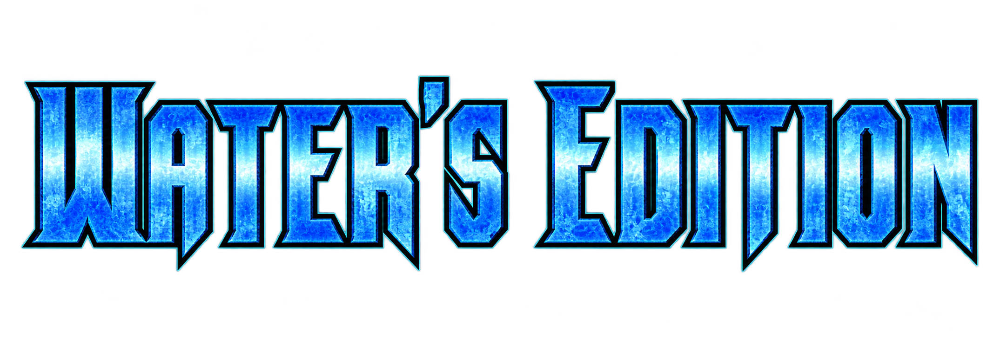
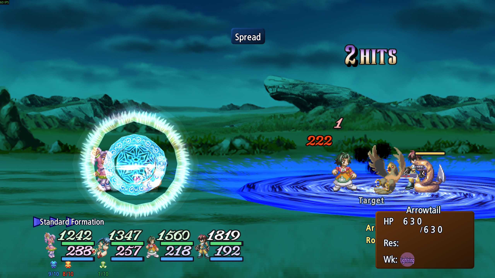
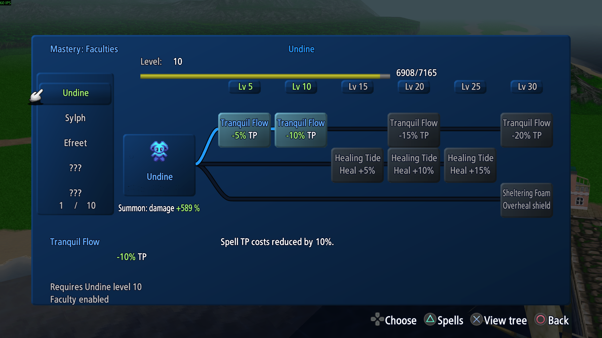
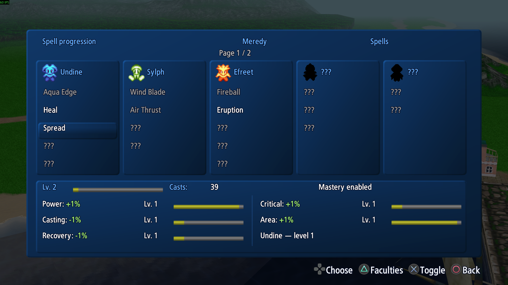
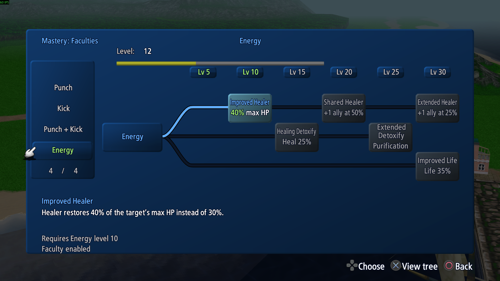

# Tales of Eternia Remastered — Water's Edition

  

A combat, progression and interface overhaul for **Tales of Eternia Remastered on Windows / Steam**.
Most features can be switched on or off in **Mod settings**, so you can choose the changes you enjoy.

I'm Water, a player who wanted to adapt a game I love to my own taste. I'm not a programmer: **all of this mod's code was written by AI**. This is my personal project, shared with anyone who wants to try it.

## Download and install

**[Download](https://github.com/Water130/tales-of-eternia-waters-edition/releases/latest)** · [Nexus Mods](https://www.nexusmods.com/talesofeterniaremastered/mods/13) · [Installation guide](docs/INSTALLATION.md)

Requires **Steam build 25190541**. Back up your saves and close the game first.

1. Download and extract the mod archive.
2. Run **Install.cmd**, check the game folder and confirm with **Y**.
3. Wait for **Installed and verified**, then launch through Steam.

To update, remove the previous version with its own **Uninstall.cmd** first. The [installation guide](docs/INSTALLATION.md) also covers removal and troubleshooting.

## Combat and controls

- A dynamic battle camera and a redesigned HUD, with casting and item cooldown bars.
- Adjustable TP recovery, elemental damage colors and overlapping spell effects. Some spells still need to wait for one another.
- **Artesphere:** three pages of arte assignments, with controller shortcuts and configurable keyboard keys.
- Optional casting cancellation and **Guard + Up** jumping.

## Magic and progression

- Separate spell mastery for **Keele and Meredy**, with bonuses earned through use and a catch-up system for the mage who is behind.
- **Craymel faculty trees**, earned Craymel EXP and individually selectable bonuses.
- **Spark Wave** (*Vague d'étincelles*) through Volt and **Fear Flare** (*Rafale ardente*) through Efreet, available to both mages.
- Expanded **Reid and Farah mastery trees**, including new chaining options, combat faculties and Farah's Energy healing progression.
- Four team-up artes that can be learned and used independently.

## Interface and convenience

Mastery pages, progression gauges, elemental icons, enemy scan memory and skit shortcuts make information easier to find. Settings are saved automatically, and the interface supports English and French.

[Feature overview](docs/FEATURES.md) · [Detailed feature reference](docs/FEATURE-REFERENCE.md) · [Controls](docs/CONTROLS.md) · [Updates and fixes](https://github.com/Water130/tales-of-eternia-waters-edition/releases)

## Screenshots

| Combat | Craymel faculties |
| --- | --- |
|  |  |
| Spell mastery | Farah's Energy |
|  |  |

[Screenshot gallery](docs/GALLERY.md) · [Nexus Mods gallery](https://www.nexusmods.com/talesofeterniaremastered/mods/13?tab=images)

## Before you play

Created and directed by **Water**, with **all code written by AI**. Bugs and crashes can occur, including new issues after updates. Fixes, support and future updates are not guaranteed. Use at your own risk and keep backups of your saves and mod settings; restoring game files cannot restore lost progress.

[About and sharing permissions](docs/ABOUT.md) · [Player guides](docs/README.md) · [Build from source](BUILDING.md)

Unofficial fan mod, not affiliated with or endorsed by Bandai Namco Entertainment.
