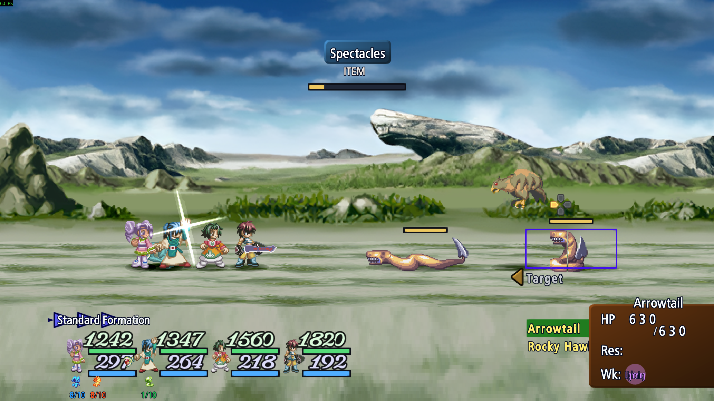
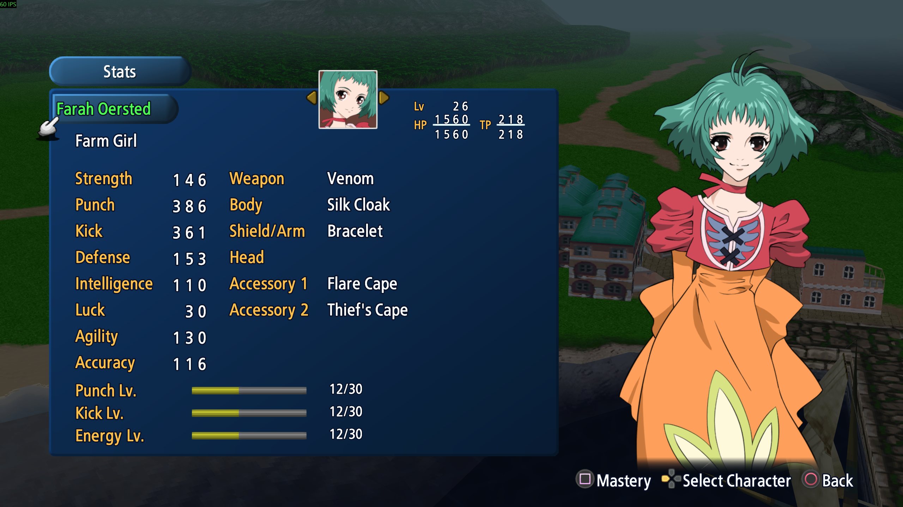
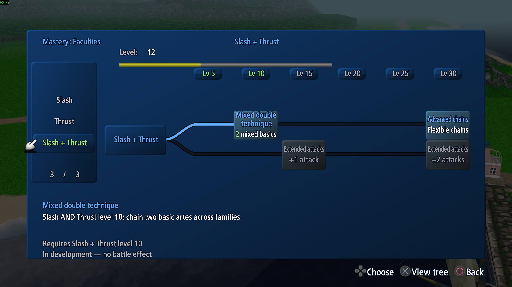
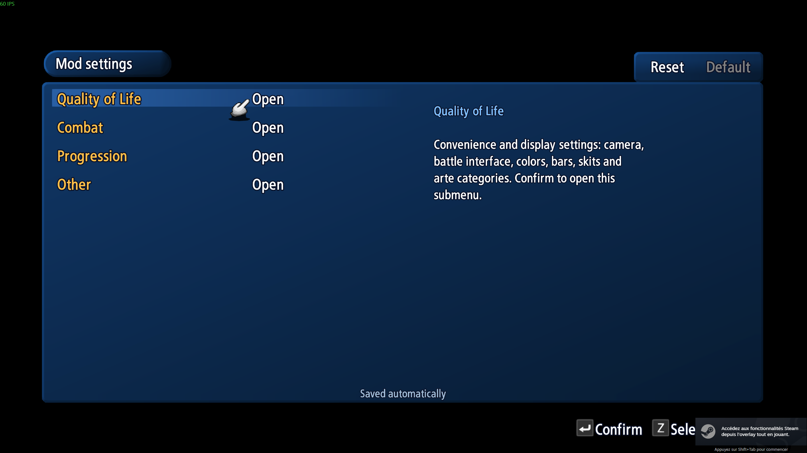
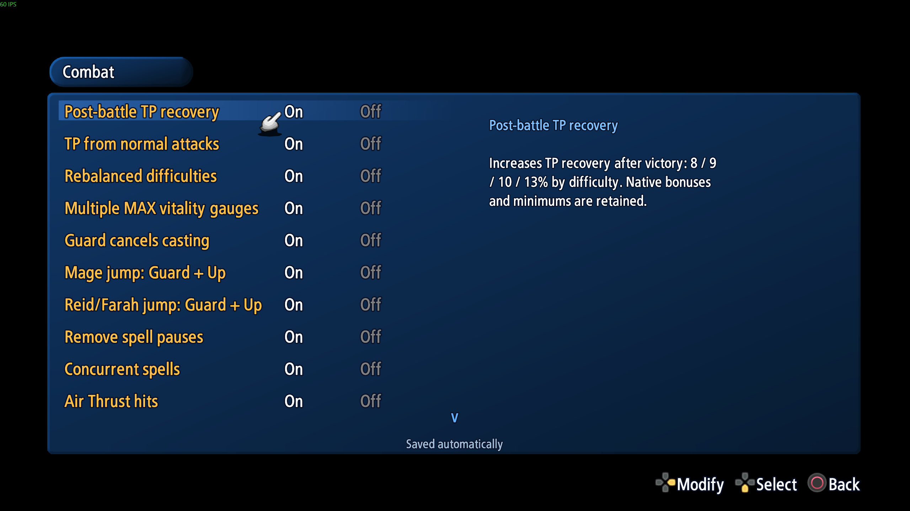
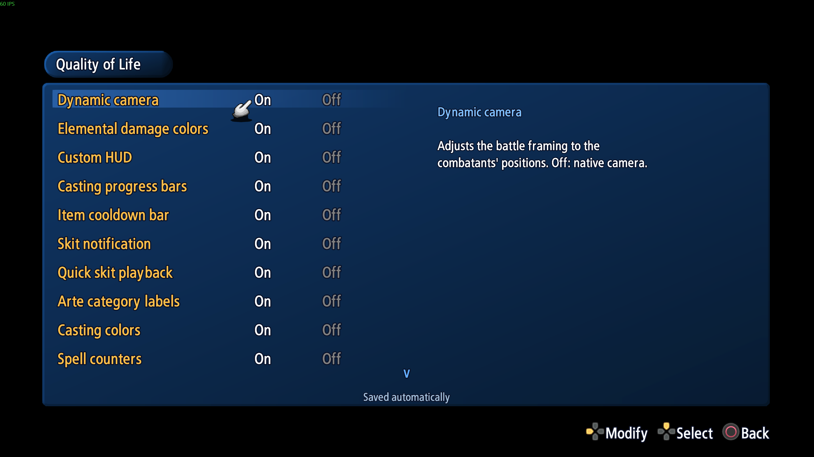
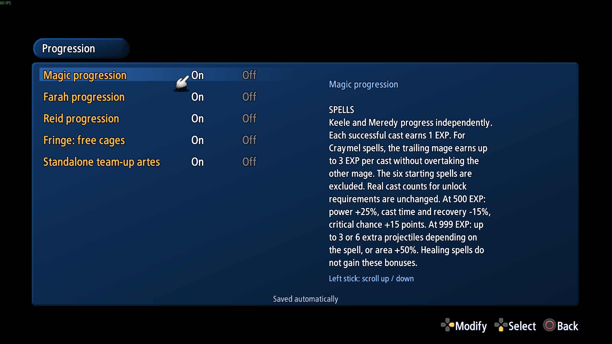
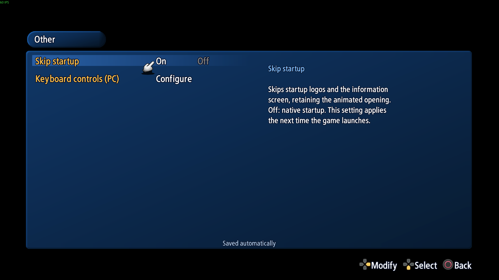

# In-game screenshots

[Back to Water's Edition](../README.md) · [Download and install](INSTALLATION.md) · [Nexus Mods gallery](https://www.nexusmods.com/talesofeterniaremastered/mods/13?tab=images)

Screenshots provided by Water, showing the English interface. Click any image to
view the original PNG. The mod is in development, so wording and layout may change.
See [Features and limits](FEATURES.md) for the published release's supported behavior.

## Combat

### Spread and the custom HUD

Spread in action, alongside the party's HP/TP bars, Craymel vitality indicators,
colored damage numbers and enemy scan information.

### Targeting and scan information

Enemy HP bars above the target frames, the item cooldown gauge and the native
Spectacles information bubble with its elemental weakness icon.

## Progression

### Undine's faculties

A rooted Craymel tree with level milestones, EXP progress, unlocked paths and
individual faculty effects. The selected node shows its TP cost reduction.

### Spell mastery

Meredy's spell list and the selected spell's uses, overall level and separate
power, casting, recovery, critical and area growth gauges.

### Farah's Energy faculties

Farah's healing progression, including Improved Healer and later Energy milestones.
Locked faculties are shaded and the selected effect is explained below the tree.

### Farah's stats and mastery access

Punch, Kick and Energy levels on the stats screen, with a shortcut to the mastery pages.

### Reid's mixed mastery tree — development preview

The Slash + Thrust page combines normal-attack extensions with proposed arte-chain
faculties. **The selected Mixed double technique is a preview with no battle effect**,
as indicated in the screenshot; it is not an implemented combo feature.

## Mod settings

### Settings categories

Four groups organize the options: Quality of Life, Combat, Progression and Other.
Choices are saved automatically.

### Combat options

Combat switches cover TP recovery, difficulty adjustments, vitality gauges,
casting controls, jumps and supported spell effects.

### Quality-of-life options

Camera, HUD, casting bars, item cooldown, skit and display options.

### Progression options

Grouped switches for magic, Farah and Reid, plus Fringe and standalone team-up
artes. Long descriptions can be scrolled with the right stick. This capture contains
an earlier catch-up description; the [published feature guide](FEATURES.md) explains
how credited uses now contribute to progression and use-based requirements.

### Startup and keyboard options

Startup skipping and access to the PC keyboard configuration.

